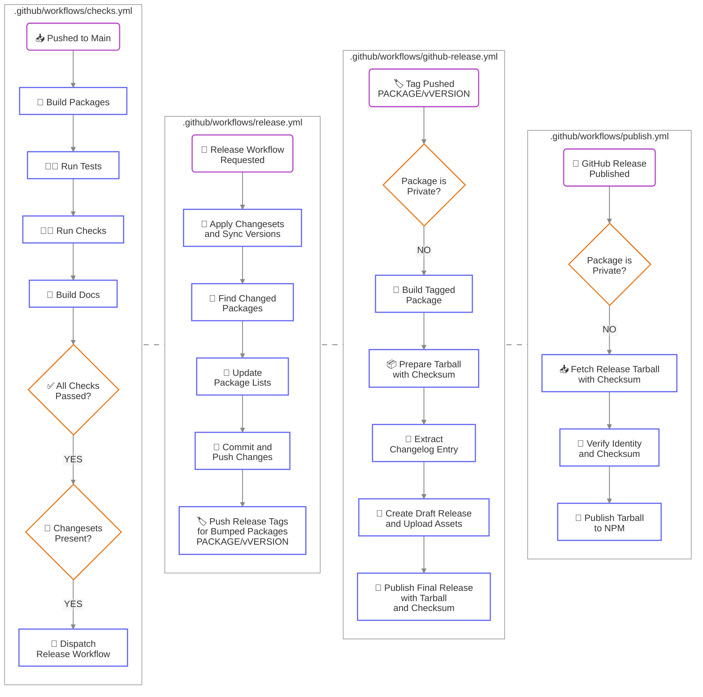

# 📦 Simbo's Packages

> A monorepo for my npm packages.

## Packages

<!-- PACKAGES -->

There are currently _**30**_ packages managed in this repository.

<!-- /PACKAGES -->

See the [`PACKAGES.md`](https://github.com/simbo/packages/blob/main/PACKAGES.md)
for a comprehensive list of all packages.

## Package Requirements

All packages require Node.js `^22.22.2 || ^24.15.0 || >=26.0.0`. Node.js 20 is
no longer supported. See individual package READMEs for peer dependencies and
configuration requirements.

## Development

### Requirements

- a linux-based operating system
- Node.js 24.21.0 (see `.nvmrc`) via [nvm](https://github.com/nvm-sh/nvm)
- [pnpm](https://pnpm.io/) 12 (see `packageManager` in `package.json` for the
  exact version)

### Setup

```bash
git clone git@github.com:simbo/packages.git
cd packages
nvm install
pnpm install
pnpm run each:build
```

### Toolset

- Repository Management
  - [pnpm](https://pnpm.io/)
  - [Turborepo](https://turbo.build/)
  - [Changesets](https://github.com/changesets/changesets#readme)
  - [Commitlint](https://commitlint.js.org/)

- Documentation
  - [TypeDoc](https://typedoc.org/)

- Testing and Quality Control
  - [Vitest](https://vitest.dev/)
  - [ESLint](https://eslint.org/)
  - [Prettier](https://prettier.io/)
  - [CSpell](https://cspell.org/)

### Usage

#### Building

```bash
# build all packages
pnpm run each:build

# build a package
pnpm run each:build --filter=<TURBO_SELECTOR>
```

#### Dependencies

```bash
# install dependencies for all workspaces
pnpm install

# add a dependency to a workspace
pnpm add --filter=<PNPM_SELECTOR> [-D] <DEPENDENCY>

# remove a dependency from a workspace
pnpm remove --filter=<PNPM_SELECTOR> <DEPENDENCY>

# interactively update dependency versions
pnpm update --recursive --interactive --latest
```

#### Tests

```bash
# run all tests for all packages
pnpm run test
# or for a specific package
pnpm run --filter=<PNPM_SELECTOR> test

# run tests in watch mode
pnpm run [--filter=<PNPM_SELECTOR>] test:watch

# run tests in ui mode
pnpm run [--filter=<PNPM_SELECTOR>] test:ui

# run repository helper script tests
pnpm run test --project scripts
```

Vitest 5 clears mock call history before each test. Coverage includes all source
files selected by `coverage.include`, including untested files. To open the test
UI, use the URL containing the authentication token printed by Vitest.

#### Checks

```bash
# run all possible checks, builds, and tests
pnpm run preflight

# run checks for all packages
pnpm run each:check

# run repository-level checks
pnpm run check

# prettier
pnpm run [--filter=<PNPM_SELECTOR>] check:format
pnpm run [--filter=<PNPM_SELECTOR>] fix:format

# eslint
pnpm run [--filter=<PNPM_SELECTOR>] check:eslint
pnpm run [--filter=<PNPM_SELECTOR>] fix:eslint

# cspell
pnpm run check:spelling

# types
pnpm run [--filter=<PNPM_SELECTOR>] check:types

# workspace boundaries
pnpm run check:boundaries
```

#### Docs

```bash
# generate API docs for all packages using typedoc
pnpm run docs

# serve the documentation locally
pnpm run serve:docs
```

### Releases

Adding changesets to the main branch will automatically create releases for the
affected packages. Each package is built and packed once for its GitHub release;
the npm publishing workflow verifies and uploads that same archive. See
[NPM_PUBLISHING.md](./NPM_PUBLISHING.md) for first publishes and retries.

#### Continuous Integration Flow



## License

[MIT © Simon Lepel](https://simbo.mit-license.org/2025/)
