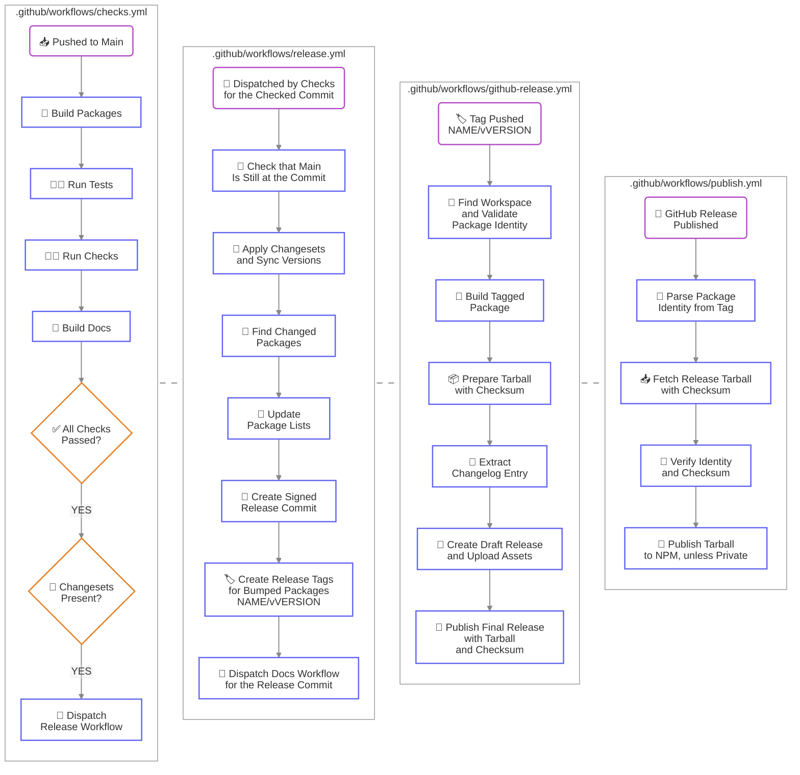

# 📦 Simbo's Packages

> A monorepo for my npm packages.

## Packages

<!-- PACKAGES -->

There are currently _**30**_ packages managed in this repository.

<!-- /PACKAGES -->

See the [`PACKAGES.md`](https://github.com/simbo/packages/blob/main/PACKAGES.md)
for a comprehensive list of all packages.

## Package Requirements

All packages require Node.js `^24.15.0 || >=26.0.0`. Node.js 22 is no longer
supported. See individual package READMEs for peer dependencies and
configuration requirements.

## Development

### Requirements

- a linux-based operating system
- Node.js 26.13.1 (see `.nvmrc`) via [nvm](https://github.com/nvm-sh/nvm)
- [pnpm](https://pnpm.io/) 12 (see `packageManager` in `package.json` for the
  exact version)

### Setup

```bash
git clone git@github.com:simbo/packages.git
cd packages
nvm install
pnpm install
pnpm run each:build
```

### Toolset

- Repository Management
  - [pnpm](https://pnpm.io/)
  - [Turborepo](https://turbo.build/)
  - [Changesets](https://github.com/changesets/changesets#readme)
  - [Commitlint](https://commitlint.js.org/)

- Documentation
  - [TypeDoc](https://typedoc.org/)

- Testing and Quality Control
  - [Vitest](https://vitest.dev/)
  - [ESLint](https://eslint.org/)
  - [Prettier](https://prettier.io/)
  - [CSpell](https://cspell.org/)

### Usage

#### Building

```bash
# build all packages
pnpm run each:build

# build a package
pnpm run each:build --filter=<TURBO_SELECTOR>
```

#### Dependencies

```bash
# install dependencies for all workspaces
pnpm install

# add a dependency to a workspace
pnpm add --filter=<PNPM_SELECTOR> [-D] <DEPENDENCY>

# remove a dependency from a workspace
pnpm remove --filter=<PNPM_SELECTOR> <DEPENDENCY>

# interactively update dependency versions
pnpm update --recursive --interactive --latest
```

#### Tests

```bash
# run all tests for all packages
pnpm run test
# or for a specific package
pnpm run --filter=<PNPM_SELECTOR> test

# run tests in watch mode
pnpm run [--filter=<PNPM_SELECTOR>] test:watch

# run tests in ui mode
pnpm run [--filter=<PNPM_SELECTOR>] test:ui

# run repository helper script tests
pnpm run test --project scripts
```

Vitest 5 clears mock call history before each test. Coverage includes all source
files selected by `coverage.include`, including untested files. To open the test
UI, use the URL containing the authentication token printed by Vitest.

#### Checks

```bash
# run all possible checks, builds, and tests
pnpm run preflight

# run checks for all packages
pnpm run each:check

# run repository-level checks
pnpm run check

# prettier (formats the whole repository)
pnpm run check:format
pnpm run fix:format

# eslint
pnpm run [--filter=<PNPM_SELECTOR>] check:eslint
pnpm run [--filter=<PNPM_SELECTOR>] fix:eslint

# cspell
pnpm run check:spelling

# types
pnpm run [--filter=<PNPM_SELECTOR>] check:types

# workspace boundaries
pnpm run check:boundaries
```

The boundaries check also enforces package layers. Each package declares one tag
in its `turbo.json`, and the root `turbo.json` defines which tags may depend on
each other, including transitive and development dependencies:

| Tag      | Packages                                    | May depend on           |
| -------- | ------------------------------------------- | ----------------------- |
| `config` | shared configurations, like `eslint-config` | `config`                |
| `core`   | utilities without internal dependencies     | `config`                |
| `lib`    | libraries and plugins                       | `config`, `core`, `lib` |
| `cli`    | command line tools                          | `config`, `core`, `lib` |
| `meta`   | the private `packages-changelog` package    | nothing depends on it   |

No package may depend on `cli` or `meta` packages. Every workspace implicitly
depends on the repository root, so the root must only add `config` packages as
development dependencies.

The root uses `monorepo-packages-list-cli` from its build output
(`packages-list.config.ts`, `packages-list` script) without declaring it, so the
layer rules stay intact; the Turbo root tasks build it first.

#### Docs

```bash
# generate API docs for all packages using typedoc
pnpm run docs

# serve the documentation locally
pnpm run serve:docs
```

### Releases

Adding changesets to the main branch will automatically create releases for the
affected packages. Each package is tagged as `<name>/v<version>` with its full
package name, and built and packed once for its GitHub release; the npm
publishing workflow verifies that same archive and uploads it unless the package
is private. See [NPM_PUBLISHING.md](./NPM_PUBLISHING.md) for first publishes and
retries.

The workflows hand over with `gh workflow run` and the full SHA of the commit.
The Release and Docs workflows run only when dispatched by the previous workflow
on `main`; manual runs are skipped. Retry a failed run with "Re-run", which
keeps the original actor.

#### Writing Changesets

Each changeset becomes one entry in the changelogs of its packages: the first
paragraph is the entry, everything after it is nested below. Keep changelogs
readable by writing changesets by topic:

- Add at least one changeset to every pull request or commit on `main`. Use a
  package changeset when the published package changes for its users (behavior,
  API, types, runtime dependencies, shipped docs). Record everything else, such
  as tooling, CI, docs outside packages, development dependency updates and
  refactorings without user-facing changes, in a changeset for the private
  `packages-changelog` package. Never add empty changesets.
- Cover one topic per changeset. If the summary needs an "and" to join two
  topics, write two changesets. One changeset may cover several packages, with
  different bump types, if the change is the same for all of them.
- Start with a one-sentence summary in the imperative that is readable on its
  own. List the details below it; every item must belong to that summary.
- End with a paragraph on migration or impact for major changes and for changes
  that can cause new errors.
- Update a single dependency in one sentence (``Update `execa` to ^10.2.1.``).
  Update several as `Update dependencies.` with a list of names and ranges.
- Name the file after the topic, for example `update-p-queue.md`.

```md
---
'@simbo/monorepo-utils': patch
---

Update `p-queue` to ^10.0.0 and adapt to its queue behavior.

- `readWorkspaces()` reports only the workspaces that failed.
- Both functions reject a `concurrency` that is not a positive integer.
```

To preview the changelog entries, apply the changesets in a temporary worktree.
It starts from the last commit, so commit the changesets first:

```bash
git worktree add --detach ../packages-preview
cd ../packages-preview && pnpm install
pnpm exec turbo run build --filter='@simbo/prettier-config'
pnpm exec changeset version
git diff -- '**/CHANGELOG.md'
cd - && git worktree remove --force ../packages-preview
```

#### Continuous Integration Flow



## License

[MIT © Simon Lepel](https://simbo.mit-license.org/2025/)
